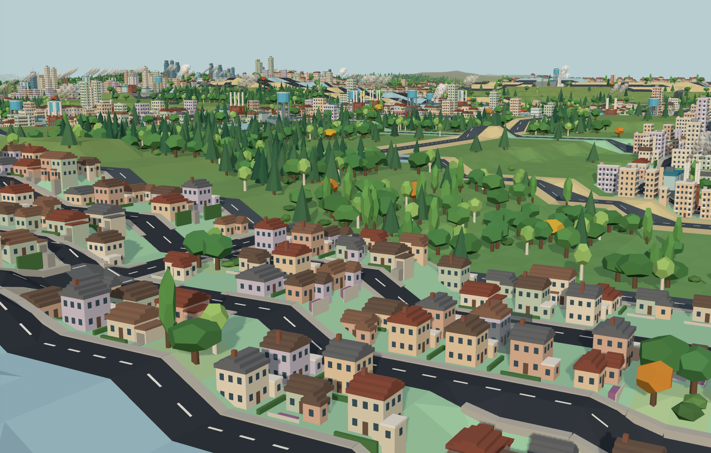

# SimMetro · City Workshop

An original, playable city-building prototype: a Python simulation and a
texture-free, procedurally modelled Three.js city. No SimCity code or assets are
used.



See [the feature inventory and phased roadmap](ROADMAP.md) for the path from this
prototype to a full-featured SC4-style city simulator, including completion gates.

## Run on Windows

Requires Node.js 22.18+ and Python 3.15 (tested on 3.15).
Commands below use PowerShell.
`npm.cmd` avoids Windows PowerShell's script execution-policy restriction.

```powershell
# First-time setup. If Python is not on PATH, uv can provide it.
uv venv --python 3.15 .venv
uv pip install --python .venv\Scripts\python.exe -r requirements.txt
npm.cmd install

# Build the UI, then serve everything from Python.
npm.cmd run build
python main.py
```

Open **http://127.0.0.1:8000**. Keep the terminal running. Do not use multiple
Uvicorn workers: this milestone has one authoritative, in-memory region.

For subsequent starts, just run `python main.py`. The launcher automatically uses
the project's `.venv` when present. Use `python main.py --port 8001` for another port.
If Python is not on PATH, run `.\main.cmd` instead; it uses `.venv` directly.

Server, access and application output is written to the rotating `logs/simmetro.log`
file instead of flooding the terminal. Four 5 MB historical files are retained.
Use `python main.py --log D:\path\simmetro.log` to choose another location.

Without `uv`, use an installed Python to run `python -m venv .venv`, followed by
`.\.venv\Scripts\python.exe -m pip install -r requirements.txt`.

For frontend development, run the backend as above and `npm.cmd run dev` in a
second terminal. Open the Vite URL it prints; Vite proxies `/api` to Python.
Rebuild the frontend before using the Python-served UI again. Restart Python
after the first build so it mounts the generated UI.

## Play

You begin with a small town and $24,000, set in the middle of a
100 x 100 coastal district in a streamed region. Terrain supports levels -32 through +96: a western sea, inland lakes, beaches, rolling hills, and snowy peaks.
Neighbouring tiles never differ by more than one level, so roads and lots
always follow the land. The starter streets do not extend to the district edge.
Local roads support power, jobs, commuters and freight without a connection
to the district edge.

The art style is "SC4 without textures". Terrain is one continuous, faceted
heightfield of flat-coloured triangles: same-level areas form flat plateaus,
and each change of level becomes a ramp spread across the two neighbouring
tiles. Roads and zone lots are painted onto that surface, so a road climbs a
hill by driving up the ramp. Its steepest grade is one level per tile. Buildings
sit at their tile's level, with a foundation going down into the downhill side.
Wherever a building or park faces a road, a raised pavement runs along the road's
verge in front of it, following the slope and staying clear of the lanes.

- **Inspect / 1:** click a tile for its development, elevation or water depth,
  power, and road access.
- **Road / 2:** select Street, Local road, Avenue or Express road, then drag to
  build. Diagonal drags create connected stair-step roads. Paint existing roads
  to change their type, paying the full new construction price per changed tile;
  repainting the same type is free. Old saves retain local roads.

  | Type | Build/tile | Monthly upkeep | Capacity | Free-flow minutes/tile |
  | --- | ---: | ---: | ---: | ---: |
  | Street | $6 | $1 | 150 | 0.45 |
  | Local road | $12 | $2 | 400 | 0.30 |
  | Avenue | $30 | $5 | 900 | 0.24 |
  | Express road | $50 | $8 | 1,400 | 0.18 |

  Road types have distinct surface shades; streets omit centre dashes. Capacity
  and speed affect commute routing and congestion. All types occupy one tile,
  provide lot access and power connectivity, and use the same animated two-way
  lanes and junction rules. Express roads are not limited-access motorways.
- **Residential / 3, Commercial / 4, Industrial / 5:** paint zones directly beside
  roads. Choose a subtype in the panel under the tools (see below). Serviced
  zones grow through up to four development levels. Businesses also need a local
  surplus of workers before they open or expand. Repainting an undeveloped zone
  with another subtype changes its type.
- **Power / 6:** place coal, solar, nuclear, wind or battery facilities beside a
  road. Choose the subtype in the tool panel.
- **Water / U, pipes / J, remove pipes / K:** place a pump or tower, connect
  its entrance road and power, then pipe its northwest anchor and neighbourhood.
  See Water and underground infrastructure below for capacities and shortages.
- **Power lines / L:** drag pylons across dry empty land, or place aligned pylons
  up to 8 tiles apart to bridge gaps, including water. Lines can cross roads
  without replacing them. Adjacent roads and lots share power automatically.
- **Park / 7:** place green space with a small nearby move-in bonus, with $8 monthly upkeep per tile.
- **Bulldoze / 8:** remove development before replacing it. There are no refunds.
- **Raise land / 9, Lower land / 0:** drag a rectangle of empty tiles to move it
  one level, $20 per changed tile. Surrounding empty land is reshaped
  automatically to keep slopes gentle. The change is rejected if it would
  disturb development. Lower land below sea level to dig lakes, or raise the
  seabed to reclaim it.
- Scroll to zoom, right-drag to orbit, middle-drag or WASD/arrow keys to pan.
  Escape cancels a stroke. Touch supports single-finger construction and
  two-finger camera navigation. Zoom out to see the whole region.
- Use map layers to check zoning, power service, local road access,
  terrain elevation and traffic volume.
- Speeds: **Ⅱ** pause, **Day** (live: one day per real minute, so a month takes
  30 minutes), **1×** (one month every two seconds) and **3×**. Space pauses
  and resumes the last running speed. The time of day always runs at one day per
  minute, so cars and day/night lighting animate in every mode; only in Day mode
  does the calendar follow that clock.
- **▶ Showcase** hides the interface and slowly circles the current view centre,
  once every 12 game hours, for recording footage. The elevation rises and falls,
  tilting toward the horizon at night to show the stars. The zoom breathes
  between about 0.55× and 1.6× of the distance you started from, so a wide shot
  stays wide and a close-up stays close. Esc or the exit button returns control.

### Streamed districts and region view

Each city district is **100 x 100 cells**. The starting town is district `(0, 0)`.
Pan across a boundary to generate and enter new, initially undeveloped districts;
negative coordinates work too. **Region view** zooms out, and **Starting city**
returns to the original district. Zoom back in to build and inspect.

The camera's district is the focused simulation and its eight neighbours are
materialised and run as a 3 x 3 active window. World coordinates are canonical:
storage chunks are derived from them, roads join across loaded chunk edges, and
employment is matched over the resulting continuous road components. Detailed
vehicle animation remains focused near the camera.

Detailed districts now load by distance from the view target to each district's
bounds, before the camera crosses an edge. The loading radius grows from 96 to
144 cells with zoom, with an extra 32-cell retention band to prevent repeated
loading/unloading near a threshold. This includes neighbours at edges and corners.
Nearby developed districts run full-rate simulation; distant ones batch simulation
every two real seconds with up-to-30-minute power dispatch. Monthly growth,
employment, condition and budgets still run. Battery dispatch and outage timing
are approximate offscreen. Empty terrain has no economy to simulate.

Nearby districts use the same detailed renderer as the focused city: matching
terrain, building models, trees, windows, shadows, smoke and wind turbines. They
share one WebGL context and animation loop. Detailed vehicle simulation remains
in the focused city. Farther districts use simplified building masses and terrain
sampled every 4, 16 or 32 cells. All LODs retain matching half-cell borders to avoid
cracks. The view retains at most a 7 x 7 patch and releases geometry outside it.
Sky-coloured distance fog follows zoom and time of day. The detailed view switches
to overview meshes at distance 300 and back at 260. Render cache identities reset
on region load, including when the loaded terrain shares old revision numbers.

New regions use six octaves of seeded gradient-Perlin noise in absolute world
coordinates, with feature wavelengths of 128, 64, 32, 16, 8 and 4 cells. Smaller
hills, valleys and terrain variations fit the city-building scale. There is no district-local
normalization, repeated border template or mirroring. Border vertices average
terrain from both sides, so slopes continue across region edges at every LOD.
The starter town follows the natural terrain; if its usual position is wet, the
layout moves to the nearest dry site without changing the land.
Natural terrain is limited to -12 through +32 levels, with each level 0.6
world units tall. The wider -32 to +96 range remains available for terrain editing
and save compatibility. Elevation colours, woodland and snow bands match the
smaller landscape; neighbouring cells still differ by at most one.
NumPy batches generation to keep region streaming responsive.
Empty visited districts can be evicted and regenerated; developed districts stay
in memory and continue simulation. Terrain generation runs away from the main
simulation event loop. The cache is bounded, but memory and simulation cost still
grow with the number of **developed** districts; this is not yet a worker-based
simulation of an arbitrarily populated world.

Budgets, power and water are currently chunk-local. Roads and labour markets
cross loaded chunk boundaries; detailed vehicle routes are still rendered only
for the focused chunk.
Terraforming is rejected if any part of its slope cascade would change the outer
row of a district, preserving shared terrain until cross-district transactions
are implemented. Construction strokes never cross districts.

Saves include the region's explored districts, generated-terrain basis, focused
district and all retained city states. Older 200 x 200 and 256 x 256 city saves
cannot fit into the smaller district and are rejected explicitly rather than
cropped. Generator versions are persisted:
old saves keep their original terrain and generation profile (including earlier
Perlin versions) so development is not
moved or submerged. Start a fresh region (restart the server without loading an
old save) to explore the new Perlin landscape.

### Traffic and daily routines

Each month's employment result is turned into a daily trip plan
(`backend/traffic.py`). Within each road network, homes send their employed
residents to the nearest workplaces that still need staff (repeated multi-source
breadth-first searches over road tiles). Shift times vary by home and workplace:
offices and shops start between 07:30 and 10:00, with some part-timers from midday.
Industry starts 05:30-07:30, and a quarter works a late shift from 14:00. Shifts
last 8-9.5 hours. One in four residents who don't work makes a daily shopping
trip, and staffed factories send trucks to the nearest developed commercial lot
on their road network.

Routes are assigned incrementally with congestion in mind. Each home's commuters
are routed in four slices. Every slice takes the currently quickest path, with
each road tile slowed by a BPR-style curve against each road type's capacity. Its load is
added before the next slice, so a busy road sheds commuters onto parallel
streets or longer detours once they become quicker. Light traffic keeps to the
shortest route. The dashboard shows daily commuters, the average commute,
congested road tiles, vehicles on the road, cars stopped in queues and how many
people each on-screen car represents. Inspect a home to see its residents' day
(including how many routes a commute is split over), a business for its staff's
shifts, or a road for its peak load.

The browser (`src/traffic.ts`) turns the plan into a car-following micro-sim:
- **Varied journeys.** Each driver has their own habits (early or late, how
  long they stay on) plus daily randomness: departures spread across about half
  an hour, around 6% of workers are absent on any day, and shoppers don't go
  every day.
- **Personal space.** Cars follow the car ahead in their lane with a minimum gap
  and time headway, so they queue nose-to-tail instead of overlapping.
- **Lanes and junctions.** Cars keep right on marked lanes (white centre dashes)
  and stop at white stop lines where three or more roads meet. At a junction
  each movement (straight, left, right) follows its own curve. A car only enters
  when no crossing movement is inside the junction and there's room beyond it.
  Waiting cars go first come, first served, with zipper merging into the same
  exit. Cars pulling out of driveways wait for a gap.
- **Fewer, representative cars.** The fleet is thinned until the busiest road
  carries at most about 80 cars a day (1,500 cars at most), so each car stands
  for several people. The traffic panel shows how many.

Limits: cars cross a tile in about 8 game minutes, so on-screen driving is slower
than the computed commute minutes. There's no lane changing, and a car stuck for
about two hours (the time to drive 15 tiles) is let through as a "ghost"
to break any rare gridlock. Commute times now influence desirability and growth; a separate happiness model is not implemented.

Construction is charged per unique changed tile. Invalid strokes are rejected
in full, without partially spending money. Building on water is rejected; raise
the land first.

### Zone subtypes

| Zone | Subtypes | Effect |
| --- | --- | --- |
| Residential | Low, medium, high density | Growth caps at level 2, 3 and 4 (24 residents per level) |
| Commercial | Retail, office, entertainment | 12 jobs/level up to level 3; 16 jobs/level; 10 jobs/level, with 7-hour evening shifts starting 16:00–18:45 |
| Industrial | Manufacturing, high tech, farming | 20 jobs/level, smoky; 14 jobs/level, clean; 6 jobs/level up to level 3, no smoke |
| Power | Coal, solar, nuclear, wind, battery | Generation and storage capacities as listed below |

Inspect a lot to see its subtype, level cap and staffing.

### Buildings and employment

There are 69 original, texture-free building archetypes, plus power-line pylons.
- **Homes:** bungalows and small houses through terraces, apartments and twin towers.
- **Retail:** shops and market sheds through showrooms, department stores, shopping centres and retail parks.
- **Offices:** small offices and bank branches through office pavilions, glass offices and skyscrapers.
- **Entertainment:** diners and pubs, cinemas, bowling alleys, theatres, casino hotels, hotel towers and arenas.
- **Manufacturing:** garages and worksheds through freight depots, warehouses, mills and large factories.
- **High tech:** start-up units, labs, data centres, campuses and semiconductor plants.
- **Farming:** crop fields, market gardens, farmsteads, greenhouses, dairy farms and grain elevators.
- **Power stations:**
  - Coal: a brick generating hall with four white corner chimneys and a coal yard, smoking day and night.
  - Solar: rows of tilted panels.
  - Nuclear: two cooling towers that steam continuously, plus a reactor dome.
  - Wind: a tall mast with an animated three-blade rotor.
  - Battery: storage containers and inverter equipment.

Growth changes their silhouettes, not just their height. Facades are built
storey by storey: homes get punched windows, balconies with doors and rails,
shopfronts and awnings; offices get ribbon windows or full curtain walls.
Seeded placement varies colours and orientation, consistently across saves. All
growable lots currently occupy one tile; water facilities have larger footprints.

Residential buildings have capacity for 24 residents per level; new capacity
fills gradually rather than instantly. Homes need road access, power, water
(or migration grace) and a desirability score of at least 50 to accept arrivals.
They gain one resident per month plus one per 15 score points above 50, up to
capacity. The starter homes begin full. Inspect a home to see its occupancy.

### Desirability and neighbourhood recovery

The **Desirability** map layer and each zoned lot's inspector use the same backend
calculation as growth. Red is below 40, yellow 40-49, green 50-69 and teal 70+;
grey cells are not zoned. The dashboard reports average suitability and counts
of low-score and declining lots. The score describes location suitability,
separately from category demand, staffing and essential service requirements.

Each lot starts from a base 50 points. The inspector lists every contribution:

- Road access: -35 without frontage. Missing roads also block growth immediately.
- Local jobs: homes gain +15 when their road network has vacancies. Businesses
  gain +10 with a local workforce, or -10 without one. Disconnected lots receive
  no job/workforce bonus. No workplaces yet is neutral for homes so new towns
  can establish their first residents.
- Parks in the surrounding five-by-five area must connect to the same road
  network. Homes gain +5 each, capped at +20; commerce and high tech gain +3,
  capped at +12. Manufacturing and farms receive no park bonus.
- Nearby developed manufacturing imposes -10 per lot on homes, high tech and
  farms, or -5 on commerce, capped at -40. Manufacturing itself is tolerant.
  This is a proximity nuisance index, not an air-pollution simulation.
- Actual assigned one-way commute times are weighted by commuter counts for
  homes and workplaces. Each minute above 20 costs 0.75 points; failed assigned
  trips add a proportional penalty. The combined commute penalty caps at -25.
  Lots with no assigned commute receive no bonus or penalty.
- Power and water reliability each cost up to 25 points for lost service,
  measured as time-weighted supplied fractions over the monthly interval.
  Current service is used before any history exists. Water migration grace
  suppresses the water score penalty, but actual unmet demand remains visible.

Contributions produce a target clamped to 0-100. Each monthly score moves 35%
toward that target, snapping to it within 0.5 points. First assessments initialise
from current conditions with no accumulated decline. Inspection does not advance
scores or service samples. The displayed target can respond to construction
before the monthly score catches up; current service failures block growth
immediately, regardless of amenities or the score.

Below 40 for three monthly assessments causes gradual losses: homes lose 5% of
occupants (at least one) per month, and businesses lose four condition points
in addition to any understaffing decline. Positive business condition recovery
is suspended during low-score decline. Between 40 and 45 the poor-month counter
is retained but desirability losses stop; reaching 45 clears it. Growth resumes
at 50 if other requirements hold. Existing sustained-water-shortage losses take
precedence, so they are not added to general desirability losses. Improvements
therefore produce gradual recovery rather than instant upgrades.

Save version 8 persists scores, decline counters and partial service samples;
older saves start without accumulated desirability decline. Autoplay can add
road-accessible parks to improve poor residential sites within its budget.
Land value, happiness, air/noise fields and broader environmental effects remain
separate future systems.

Commercial and industrial jobs per level depend on the subtype. Only powered,
road-served buildings contribute. Each home's workforce is 55% of its actual residents, rounded down.
Workers are shared proportionally between businesses on the **same connected
road network**, with deterministic allocation of leftover workers. Separate
networks cannot exchange workers. A lot
touching multiple networks uses the lowest-index adjacent network. Hiring is
aggregate; the trip plan below then matches each home's workers to workplaces.

Business condition starts at 100%. Every month, staffing at least 80% of jobs
repairs 4 condition points; partial staffing below 80% loses 3; no staff loses 6.
Condition is clamped to 0-100. Below 60% buildings look neglected with boarded
windows; at 20% or less they are derelict, with debris. They keep their structure
and can rehire and recover without demolition. Businesses only expand when
condition is at least 60%, staffing at least 80%, and enough spare local workers
exist for the added jobs. New businesses need spare workers too.

The dashboard reports employment, unemployment, vacancies and disrepair; inspect
a business for its archetype, staffing and condition. Demand responds to the
residents/jobs balance. Monthly taxes are $2 per resident plus $1 per **employed**
worker scaled by business condition (rounded down per business), not per empty
job. Road upkeep is $2 per tile; each power station's upkeep depends on its type.

### Electricity

Power is a connected network, not a coverage radius. Orthogonally adjacent roads,
zones (including undeveloped ones), parks and utility lots share a local grid.
Roads represent automatic buried distribution. Empty land does not conduct.
Power-line pylons connect across up to 8 tiles in a straight cardinal direction,
over empty land, water or roads, stopping at the first other pylon. Supports must
be on dry land. Buildings in the span block it; route around them or use their
adjacent local distribution. Power lines cost $15 per support and $1/month.
Visually, continuous routes use slim utility poles every four tiles, plus
endpoints, bends and junctions, with thin sagging wires. Intermediate line tiles
still carry the connection and can be inspected or bulldozed.

| Facility | Capacity | Build | Monthly upkeep |
| --- | --- | --- | --- |
| Coal | 800 kW, constant | $900 | $180 |
| Solar | 180 kW at noon; zero from 18:00 to 06:00 | $500 | $40 |
| Nuclear | 4,000 kW, constant | $4,000 | $450 |
| Wind | 120 kW rated; weather-dependent day and night | $450 | $25 |
| Battery | 1,200 kWh; 200 kW charge/discharge | $700 | $15 |

Facilities require an adjacent road to operate. Separate
electrical islands balance independently: spare supply on a disconnected network
cannot prevent a local blackout. When a grid is overloaded, whole buildings
lose service, with homes served first, then businesses and public space.
Unserved zones cannot grow or supply jobs/residents; their windows go dark.

Developed zones draw power in proportion to development level and subtype,
including during outages. Homes peak in the morning/evening, offices during
working hours, retail through the day and entertainment in the evening. Industry
retains an overnight base load; parks and roads draw a small lighting load.
Undeveloped zones draw a small service load so they can establish a connection.

Solar follows the visible sun; wind output varies deterministically with gusts
and longer weather cycles. Batteries start empty, absorb surplus and supply
shortfalls only on their own grid, at 92% efficiency each way. They have finite
charge/discharge rates and cannot create energy. Electrical time follows the
visible day at all calendar speeds, with five-minute dispatch steps; pause
freezes it. Stored energy persists through save/load.

Open **Power grid & graphs** at the top of the dashboard for live demand,
generation by source, shortages and storage; a 24-hour demand/generation
projection; half-hour meter readings over the last 48 hours; and monthly
city-wide average/peak demand versus road-served nameplate capacity. The daily
projection excludes storage dispatch and outages. Graphs include numeric data
tables. Inspect lots for their grid ID, demand, output and stored energy.
The power map layer shows actual service, not just proximity to a plant.

### Water and underground infrastructure

- **Water facility / U:** choose a groundwater pump or tower and its entrance
  orientation. Click to place the entire footprint; the preview marks the road
  entrance. Pumps occupy 2 x 1 cells (1 x 2 when rotated); towers occupy 2 x 2.
  Footprints must be dry, empty, inside the district border and vary by at most
  one terrain level. Foundations accommodate that slope.
- **Water pipes / J:** drag a connected underground route, $3 per new tile.
  Pipes coexist with roads and buildings. Connect a pipe under the facility's
  northwest anchor; for rotated facilities, continue it across the footprint
  to reach the road pipe. A facility also needs power and a road at its specific
  entrance. The water panel explains each missing requirement.
- **Remove pipes / K:** removes only pipes, $1 per tile. Ordinary bulldozing
  leaves pipes intact. Bulldozing any facility cell removes its whole footprint
  for $5, discarding its stored water. No construction refunds.

| Facility | Supply or storage | Build (whole facility) | Monthly upkeep | Power |
| --- | --- | ---: | ---: | ---: |
| Groundwater pump | 1,200 m3/day | $1,000 | $60 | 12 kW |
| Water tower | 600 m3, initially empty | $650 | $15 | 2 kW |

Groundwater is an unlimited abstract source on dry land in this first release.
Pipes have no pressure or throughput limit and their upkeep is included in
facility upkeep. Pipes serve lots within Manhattan distance two. Each lot uses
its nearest pipe (ties by tile index), so overlapping catchments cannot merge
networks or double supply. A disconnected closer pipe can isolate a consumer.
Both pumps and towers require power and their entrance road to operate; stored
water remains in an inactive tower until service is restored.

Demand is 0.5 m3/day per zoned lot plus 0.15 per resident, 0.25 per commercial
worker or 0.5 per industrial worker. Coal/nuclear lots also request 6 m3/day;
thermal power shutdown from water shortages is not yet simulated. Water shortages
are allocated proportionally within each pipe network. Production is consumed,
stored, or spilled; towers discharge only their actual stored volume. The
five-game-minute dispatch follows the day clock, like electricity, even when
the monthly economy runs faster. Offscreen districts use the same water steps.

Outside migration grace, new growth and move-ins require full water supply.
After three consecutive shortage months, homes lose 10% of their occupants
(at least one) per month; businesses lose condition. Reconnection clears the
shortage counter and normal gradual growth/recovery resumes. New starter towns
include a connected pump and pipes. Older saves without water infrastructure
receive **24 months of grace**, persisted across saves, with a visible countdown.

Use **Water pipes & supply** to see cyan pipes, green supplied lots, yellow
partial supply and red shortages. Pipe colouring takes precedence; inspect a
lot for its actual served volume and network. The dashboard shows demand,
production, unmet demand, storage, filling/drawing and facility upkeep.
Water networks remain district-local. Water quality, treatment, sewage,
pressure, extraction limits and pipe failures are future systems.

### Named saves and autosave

Enter a slot name in the top bar, then **Save region** or **Load**. Names allow
1-48 letters, digits, underscores or hyphens. `city` retains the existing
`saves/city.json` path; other slots use `saves/<name>.json`. Loading asks before
replacing the current region. All writes use atomic replacement.

The server autosaves every two real minutes into the oldest of three slots:
`autosave-1`, `autosave-2`, `autosave-3`. They can be loaded from the slot list but
cannot be overwritten by the manual Save button. Autosave errors appear in the
region panel. Rotating autosaves are bounded recovery points, not permanent
archives: make a named manual save for a milestone. Restarting still opens the
demonstration region until you load a save.

Region wrapper version 1 now contains district save version 8, including pipe
layers, facility footprints/rotation, stored water, shortage duration and grace,
as well as desirability/reliability history, occupancy, power and previous simulation state. Versions 2-7 migrate;
the old 40 x 40 format remains unsupported. Existing single-tile power plants
keep their original schema. The save belongs to the server, not the browser;
this is a local single-user app. `KSC_SAVE_DIR` can select an isolated save folder
for development runs.

### Light, weather and nature

These are purely visual and run in the browser; they don't change the simulation.

- **Sun and shadows.** The sun rises due east at 06:00, stands 45° above the
  southern horizon at noon and sets due west at 18:00. Buildings, trees and
  terrain cast shadows that follow the camera. Light warms near dawn and dusk,
  and nights turn a darker blue while staying readable.
- **Stars.** At night, square, unblurred stars fill the sky. They wheel from east
  to west with the game clock around a pole 45° above the northern horizon, on
  the same path as the sun, and fade out at dawn and below the horizon.
- **Trees.** Seven varieties (fir, pine, oak, birch, poplar, a few autumn trees
  and shrubs) grow in clumped, mixed woods. Uplands are mostly conifers; beaches
  and snowy peaks have none. Treetops lean downwind, in the direction smoke
  drifts, and rock in gusts; trunks stay still. The sway runs on real time, so it
  continues while the game is paused, and tree shadows sway too.
- **Cars at night.** Cars keep their own colours, darkened by the night light
  like everything else, and carry headlights, tail lights and a pool of
  headlight light on the road ahead.
- **Windows.** Every pane belongs to a room. Homes light a random, different
  set each day: in the evening, lights come on between 17:30 and 20:00 and go off
  between 21:30 and midnight; some early risers light up between 05:20 and 06:40
  until 06:50–08:00. About a quarter of homes stay dark all day. Office floors
  light through the working day, with a few late workers, and shops until the
  evening. Entertainment venues glow in party colours (pink, violet, amber, teal)
  from 16:00–17:30 until 00:30–02:00, and their neon sign strips (marquees, roof
  crowns, upright signs) come on at dusk every night; a third of the tubes cycle
  colour. Business windows light only when staffed; boarded windows never do.
  A lit window is the pane itself glowing (a per-pane emissive colour), not a
  second shape drawn over it, so distant windows don't flicker. After dark,
  street-level venue rooms and low neon signs also throw a fan of their colour
  across the pavement in front of them, like car headlights.
- **Smoke and steam.** Staffed manufacturing buildings with chimneys smoke during
  working hours. Coal stations smoke and nuclear cooling towers steam around the
  clock. Puffs drift downwind, grow and fade. High-tech plants and farms are
  clean, and unstaffed or derelict factories are cold. Smoke follows the game
  clock, so it freezes when paused.

Headlight pools are flat and can dip into the ground on steep uphill slopes.

## Architecture

Per-building balance data lives in `building_def/`, one JSON file per subtype.
The backend validates these definitions at startup and derives zone capacity,
jobs, power demand and generation, service coverage, water facilities and
desirability profiles from them. `GET /api/buildings` exposes the same
authoritative catalogue to clients.

- `backend/simulation.py`: deterministic headless simulation, transactional
  construction, connectivity, demand, growth, budgets, and versioned save data.
- `backend/app.py`: FastAPI endpoints and the real-time clock loop (every 0.25 s).
  Mutations execute serially on the event loop; snapshots cannot observe
  half-applied commands. `/api/traffic` serves the daily trip plan.
- `backend/traffic.py`: commute matching, routing, shopping and freight trips,
  congestion and commute times. It is recomputed lazily after changes, and its
  revision only changes when the plan does.
- `src/traffic.ts`: driver fleet, daily departures, lane and junction geometry
  and the car-following micro-sim; `world.ts` draws vehicles and lane markings
  as instanced meshes.
- `src/world.ts`: imperative Three.js renderer. It draws the sloped terrain mesh
  (an 8-triangle fan per tile, with vertex-colour painting for roads and lots),
  water, shared flat-colour materials, instanced procedural buildings and trees,
  paint strokes, and camera controls.
- `src/terrain.ts`: the continuous surface model, built from a half-tile vertex
  grid. Tile centres sit at their own level, and shared edges and corners
  average their neighbours. It also handles ray picking against the surface, so
  elevated land correctly hides tiles behind it.
- `src/main.tsx`: React dashboard, editing controls, network status, and save/load.
- `backend/power.py`: connected electrical islands, load profiles, generation
  and finite-energy storage dispatch. `GET /api/power` exposes chart data.
- `src/power.tsx`: live power report, daily and long-term graphs and data tables.
- `src/buildings.ts`: deterministic archetypes and flat-coloured multipart models,
  shared by the renderer and inspector.
- Snapshots are compact strings and arrays, gzip-compressed, and polled every
  1.2 seconds through `/api/view`, with session/revision checks for the focused city and cached LOD meshes for nearby districts.
  Terrain meshes are rebuilt only when the terrain revision changes. State
  revisions prevent stale responses from overwriting newer command results.

### Deliberate first-milestone limits

Each district is 100 x 100 with integer terrain levels. Geometry is generated directly
in the browser, not loaded from OBJ/MTL or GLB files yet. There are no textures
or external asset downloads. This prototype does not yet include transit, water
quality/treatment, pollution, rivers, bridges, tunnels, per-road-type grade limits,
automatic road grading, disasters, regional economies, general residential abandonment,
undo, or full SC4 mechanics.
Parks are decorative, not a land-value simulation. Negative treasury is allowed;
construction is blocked when unaffordable, but bankruptcy is not simulated.

The backend currently runs in **one process**, with ordinary Python tile records.
Before scaling, measure headless tick times, migrate hot fields to dense arrays,
partition local calculations into chunk jobs, then introduce persistent worker
processes and shared-memory double buffers. Regional connectivity and economics
need explicit global phases. Python threads are not presented as a CPU-scaling
solution. Binary chunk deltas, an ordered command journal, asset export, and
worker scheduling are future work rather than unimplemented promises.

## Autoplay and repeatable development scenarios

The dashboard defaults to **Continuous stress test**. It spends construction funds
above the reserve (default $5,000), repeatedly lays out connected 36-by-18
neighbourhoods (12-by-6 on tighter sites), and zones their available frontage.
It cycles all implemented road, zone, power and water facility variants, plus
parks, pylons and pipes. There is no population target, housing inventory gate,
monthly construction gate or six-month deficit buffer in stress mode.

Construction uses ordinary validated commands and actual costs. It neither grants
funds nor bulldozes existing development. The reserve limits construction spending;
operating losses can still take the treasury below it. Pausing the simulation pauses
construction. Loading or changing district stops autoplay. Settings are session-only.
The optional **Targeted growth** mode retains the older population target, twelve
actions per observed month and six-month deficit runway.

Live stress construction runs every server update, with at most four commands and
a soft 50 ms work budget. It yields between commands; an individual command or
planning pass can exceed that budget. The panel shows last construction/simulation
update timings, queued commands, catalogue coverage and recent actions. This is
load instrumentation, not automatic multicore simulation scaling.

For repeatable isolated scenarios without changing the live region:

```powershell
.\.venv\Scripts\python.exe -m backend.autoplay --seed 42 --months 12 --starting-money 2700000 --reserve 5001 --actions-per-month 128 --output runs/wealthy-stress
.\.venv\Scripts\python.exe -m backend.autoplay --mode growth --seed 7 --empty --months 120 --target 2000 --output runs/growth-7
```

`--starting-money` explicitly sets the isolated benchmark's initial treasury;
normal live autoplay never changes the treasury except through game commands.
The deterministic headless workload defaults to 64 commands before each simulated
month. Same inputs and code reproduce construction and simulation state; wall-clock
timings vary. Reports include every command, monthly roads/zones, finances,
population, water service, construction time and simulation p95. The runner writes
`report.json` and a loadable `city.json`; use distinct output directories because
these files are overwritten on repeated runs. Back up the live save before replacing
it with a generated city for inspection.

API: `GET /api/autoplay` reports status; `POST /api/autoplay` accepts
`{"enabled": true, "mode": "stress", "reserve": 5001}` or `{"enabled": false}`.
`mode: "growth"` also uses `target` (default 2000).
The stress planner lives in `backend/stress.py`. New waste, civic and other systems
need construction policy and coverage entries when implemented. Expansion currently
stays in the focused district and does not terraform; exhausted affordable terrain
is reported explicitly. It does not guarantee a balanced economy or full occupancy:
large real workloads and exposed system failures are the purpose.

## Validate

```powershell
.\.venv\Scripts\python.exe -m unittest backend.test_simulation backend.test_power backend.test_region backend.test_terrain backend.test_roads backend.test_autoplay backend.test_water backend.test_saves backend.test_desirability -v
npm.cmd test
npm.cmd run build
```

Tests cover seeded terrain (levels above and below water, slope limits, a flat
starter town), terraforming cascades and their rejection near development,
lowering land into water, starter-city growth, revenue, construction atomicity
and funds, road/power prerequisites, save round-trips and rejection of old or
invalid saves, compact API state and API validation. Power tests cover
connectivity, long spans and cuts, independent islands, renewable cycles,
load shedding, battery rate/energy limits, efficiency and save/replay.
The browser build performs
strict TypeScript checking before Vite bundles the application. Camera tests
verify perspective depth scaling, terrain picking, occlusion by hills, and
water-surface picking. Employment tests cover worker conservation, proportional
hiring, disconnected networks, business decay and recovery, growth gating, tax
effects, and condition save migration/replay. Building tests check archetype
diversity, lot footprints and derelict geometry.
